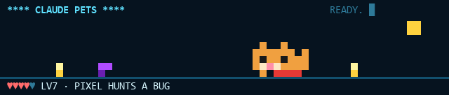
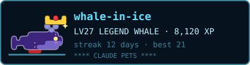
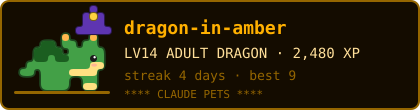

# Claude Pets

[](https://github.com/quangtm0404/claude-pets/actions/workflows/ci.yml)

A pixel pet game and retro dashboard for [Claude Code](https://claude.com/claude-code): an ice-cyan band above the prompt with your plan usage, the backlog story you're on, your branch, and a tiny pixel pet game that plays itself while Claude works.

```
              **** CLAUDE PETS ****                            ▐▌▐▌▐▌▐▌▐▌
 64K ACME-API ⎇ FEAT/E12-S03 ±3  OPUS · 12.3K TOK
 5H [████████░░] 82% ↻1H12M  WEEK [███░░░░░░░] 31% ↻3D4H  CTX 44%
 STORY E12-S03 [PARTIAL] TO RESET MY PASSWORD BY EMAIL
 E12 · SIGN-IN AND RECOVERY · 5 PTS · TASKS 1/2   TESTS:12 PASS 0 FAIL
 READY.
 █        ▪       █▄█  ▄▀              ▪
          ▪       ▀█▀█▀█          ▄▄   ▪
 ▔▔ ♥♥♡♡♡ LV3 XP 042 ◆7 · PIXEL IS GRUMPY · 5H 82% ▔▔▔▔▔▔▔▔▔▔▔▔▔▔▔▔▔▔
```

<p></p>

Players on the world board get a live badge for their GitHub profile (`/pet card`), drawn with the pet's stage, what it wears and their theme:

<p>
  
  
  
</p>

> **Early access.** Claude Pets is a *mod*: a plugin of function hooks. Mods are an early-access Claude Code feature, so they have to be available on your account for Claude Pets to load.
>
> **Not affiliated with Anthropic.** Claude Pets (plugin id `pixel-pets`) is an independent community project; it is not made, endorsed or supported by Anthropic.

## Install

```sh
claude plugin marketplace add quangtm0404/claude-pets
claude plugin install pixel-pets@pixel-pets
```

Or try it from a clone without installing:

```sh
claude --plugin-dir ./plugins/pixel-pets
```

## What it does

### The band
- **Plan usage**: the 5-hour and weekly windows as bars with reset countdowns, plus context fill. They refresh every 30 seconds, with warnings at 80% and 95%, and at 85% context.
- **Branch and worktree**: repo name, branch and uncommitted file count. A red `≠` appears when the branch names a different epic than the story you're tracking.
- **Backlog story**: status, title, epic and tasks read from your project's markdown plan (see below), not from an issue tracker. A project without one just shows `NO PLAN YET · /story plan TO POINT AT YOURS`.
- **Tests**: pass/fail from the last Playwright, Jest, Vitest, pytest, dotnet or npm test run.
- **Themes**: presets `/retro theme ice` (cyan on navy, the default), `phosphor` (green CRT), `amber`, `c64`, `mint`, `rose`, `mono`, or `paper` (dark ink on cream, for light terminals). Or your own colours: `/retro theme #FF8800` picks an accent and mixes a background from it, and `/retro theme #FF8800 on #101010` sets both. The rest of the palette is mixed from those two, so any pair stays readable.
- **Banner fonts**: `/retro font plain`, `bold` (𝗖𝗟𝗔𝗨𝗗𝗘 𝗣𝗘𝗧𝗦), `mono` (𝙲𝙻𝙰𝚄𝙳𝙴 𝙿𝙴𝚃𝚂), `double` (ℂ𝕃𝔸𝕌𝔻𝔼 ℙ𝔼𝕋𝕊), `wide` (ＣＬＡＵＤＥ　ＰＥＴＳ) or `pixel` (big pixel letters, when the band has room). A plugin can't change your terminal's own font; that's the terminal's setting (Windows Terminal: Settings › your profile › Appearance › Font face; macOS Terminal: Settings › Profiles › Text; VS Code: `terminal.integrated.fontFamily`). Retro fonts such as VT323 or Press Start 2P suit it.

### The pet game
A pixel pet walks the bottom of the band. When the band has room it's the detailed one, 12×8 pixels with a baby version of its own; in a short terminal (macOS's default 80×24, say) it's the small classic 7×4 one, so the pet never disappears. `/pet size auto|big|small` chooses. **`/pet settings`** puts every option on one screen, with buttons. On a slow computer, **`/pet motion low`** draws about a frame a second and **`/pet motion off`** has the pet sit still until something happens (a test run, a level up, a ball); `/pet motion normal` brings the walking back, and **`/pet perf`** shows how much it's drawing per minute. In the desktop app, VS Code and on badges the same pets are drawn as smooth, outlined cartoons with eyes that blink. Pick one of 14 with `/pet list` and `/pet <animal>`:

🐈 cat · 🐕 dog · 🦀 crab · 🦈 shark · 🐢 turtle · 🐁 mouse · 🦊 fox · 🐋 orca · 🐳 whale · 🐬 dolphin · 🦒 giraffe · 🐅 tiger · 🐿 squirrel · 🐧 penguin

…and three that only hatch from a blind box: 🐉 dragon · 🦄 unicorn · 🦎 axolotl.

| Event | In the game |
|---|---|
| A tool call succeeds | A coin drops; the pet collects it (+1 XP) |
| A tool call or test fails | A bug crawls in; the pet hunts and squashes it (+5 XP) |
| A green test run | +10 XP and a happy jump |
| Claude is working | The pet runs alongside |
| Idle for 2 minutes | It naps (`z Z`) |
| A long turn ends (30 s+) | It speaks: a meow, a woof, a roar, a whale song… |

**Hearts are your plan headroom.** At 70% of the fuller window the pet turns **grumpy**: ears back, red eyes, a grumpy voice. At 90% it's **furious**. At 100% it's **GAME OVER**, with a countdown to the reset. XP and levels persist between sessions.

**Helpers for subagents.** Every subagent Claude starts hatches a *helper*: a baby version of your pet with its number above it (#1, #2…). While the subagent works, the helper bustles around and earns +1 XP for each of its tool calls that works (a ◆ flashes). When the subagent finishes, the helper runs back to the main pet and hands its score over, +5 for a finished job: `▶ HELPER #1 IS HOME (Find the auth code) · +8 XP`. Up to four are drawn at once; `/pet stats` lists them all.

**A runner game, when you want it.** It's off by default. `/pet play` turns the pet's strip into a runner game until `/pet play off`; `/pet play auto` opens it by itself once Claude has worked 8 seconds. Click it, then press space (or ↑, or click) to jump the bugs. Each bug cleared scores; a run's score is XP, up to 20 a turn. Esc gives the keys back to the prompt. In the terminal and the desktop app.

**It grows up.** A baby until LV10, then an adult; at LV25 it twinkles as a legend, and at LV50 it grows wings.

**The coin shop.** Coins you collect are spendable (everything collected before 1.4 counts): `/pet shop`, `/pet buy hat`, `/pet wear crown`, `/pet wear none`. A bow ◆15, a scarf ◆25, sunglasses ◆40, a top hat ◆60, a Tết lantern ◆88 and a crown ◆200, one per slot.

**It reacts to your work.** It dances when tests go green and winces when they fail, rides a rocket when a `git push` lands, puzzles over a merge conflict until it's resolved, and naps beside a command that runs over a minute.

**Blind boxes.** You get one for each level up, each achievement and every 4 focus rounds (and 3 to start). `/pet box open` and your pet shakes it in the band until the find pops out:

| Rarity | Odds | What's inside |
|---|---|---|
| ◇ Common | 60% | flower crown, headphones, blue bandana |
| ◆ Rare | 27% | hero cape, wizard hat, rainbow scarf |
| ★ Epic | 10% | halo; pastel, shadow and ghost skins |
| ✦ Legendary | 3% | golden and galaxy skins; the dragon, unicorn and axolotl |

A find you already have is worth coins instead (◆10 to ◆150), and ten boxes in a row without an epic make the next one epic. `/pet box` shows the odds, `/pet collection` a checklist of every find (✓ found, 🔒 not yet, and how many of the 15), `/pet wear <item>` and `/pet skin <name>|none` use it, and `/pet dragon` (once hatched) switches to it. Skins and items show on your badge too.

`/pet name` asks you for a name (or use `/pet name Mochi` directly), `/pet ball` throws a ball, `/pet pat` pats it, `/pet stats` shows progress, and `/pet` on its own hides or shows the pet.

### Rows you choose
Not a developer? Pick the rows you want with the `bandRows` setting (in `/config`): any of `banner`, `git`, `usage`, `weather`, `story` and `tests`, in the order you list them. The story row only appears when you're tracking something, so nothing asks you to set up a backlog. In a short terminal the pet keeps its place and rows drop in this order: banner, git, tests, story, weather, usage.

### Weather
```
 ☀ 28°C / 82°F · CLEAR · WIND 5 KM/H · HANOI, VIETNAM
```
`/pet weather Hanoi` sets your place (or put it in the `weatherPlace` setting), `/pet weather` shows the current conditions, and `/pet weather off` forgets the place. `/pet weather here` looks your place up from your IP address, but only when you ask. The `temperatureUnit` setting picks °C, °F or both, and the wind follows in km/h or mph. Conditions come from [Open-Meteo](https://open-meteo.com) every 15 minutes.

The pet's strip shows the same sky: the sun by day, the moon and stars at night, drifting clouds, rain, snow, fog, and lightning in a storm. The pet shelters from the rain, plays in the snow, basks on a hot, clear day, and gets pushed along by strong wind.

### Your profile and pet board
`/pet board` ranks every animal you've raised by its own XP, with your lifetime totals (XP, coins, bugs squashed, helpers home, green test runs, turns), your daily streak and your achievements:

`FIRST COIN · BUG SQUASHER · PACK LEADER · GREEN STREAK · A WEEK'S STREAK · LEVEL 5 · LEVEL 10 · ZOO KEEPER`

and four for real work, counted from the commands Claude runs for you: **CLEAN SHEET** (10 green test runs in a row), **COMEBACK** (turn failing tests green 5 times), **SHIPPER** (10 commits) and **DEEP FOCUS** (10 focus rounds). `/pet board` shows the counts under your totals.

Your name comes from the `playerName` setting, else git's `user.name`, else your OS user.

### The world board (opt-in)
`/pet join` puts you on a shared leaderboard: it shows a GitHub sign-in code (no permissions requested), and once you approve it your score is sent after each turn, at most once a minute. `/pet board world` shows the top 20 and your rank; `/pet leave` deletes your entry. Only your GitHub login, level, XP, favourite pet and streak are shared, and only a hash of the board's own key is stored; your GitHub token is never kept.

The board runs at `https://claude-pets-board.claude-pets-leaderboard.workers.dev` (a Cloudflare Worker; the code is in [server/](server/README.md)). Nothing is sent until you run `/pet join`. To turn the world board off entirely, empty the `leaderboardUrl` setting. To run your own, follow [server/README.md](server/README.md) and point the two settings at it.

### Focus timer (Pomodoro)
- **`/pet focus`**: 25 minutes of focus, then a 5 minute break, round after round. The countdown sits next to `READY.` in the band; your pet guards your focus and stretches with you on breaks.
- **`/pet focus 45/5`** (or `50/10`, `90/15`; `/pet focus 45` means 45/5) sets your own times. Every fourth break is three times as long.
- Each finished round chimes and earns XP (10 for 25 minutes). **`/pet focus stop`** ends it; a round cut short earns nothing. The timer carries on through `/reload-plugins`.

### Through the day and the year
- **Break reminders**: after an hour of continuous work (a pause of 10 minutes counts as a break), your pet stretches when the turn ends and suggests you stand up and drink some water. At most once an hour, never in the middle of a turn, and not while a focus timer runs. **`/pet breaks 45`** changes the time, **`/pet breaks off`** stops them.
- **Festivals**: red lanterns at Tết, a full moon and mooncakes at Mid-Autumn, a tree in the snow at Christmas, fireworks at New Year, hearts on Valentine's Day, pumpkins and a bat at Halloween. Tết and Mid-Autumn follow the lunar calendar, worked out for each year. **`/pet festivals`** lists the next ones; **`/pet festivals off`** turns them off.
- **Keepsakes**: the first time you see each festival your pet gets something to keep, which you can't buy or find in a box: a lucky envelope (Tết), a star lantern (Mid-Autumn), a Santa hat, a sparkler (New Year), heart glasses (Valentine's) and a pumpkin hat (Halloween). `/pet collection` shows which you have.
- **Days of your own**: **`/pet festivals add 11-20 Teachers' Day`** puts confetti in the band on that day every year (up to 12 days); **`/pet festivals remove teachers' day`** drops it. **`/pet festivals preview halloween`** shows any festival for 30 seconds, any day.
- **A birthday**: your pet's adoption day comes round each year with a party hat, the band telling how old it is, and a one-off +50 XP. **`/pet birthday`** says when.
- **Chatter** (off by default): **`/pet chatter on`** and, after a turn, at most once every 20 minutes, your pet says a line in the band. A small model (Haiku) writes it from a summary made on your machine: how long the turn took and how many edits, commands and tests ran. Never your files, paths, commands, prompts or answers, and the line never goes into the conversation.

### Share your pet (opt-in, for players on the world board)
- **`/pet card`**: a live badge for your GitHub profile README, drawn by the board in your theme's colours with what your pet wears. It updates as you play; `/pet leave` removes it.
  ```markdown
  [](https://github.com/quangtm0404/claude-pets)
  ```
  It looks like the badges at the top of this page. The board refreshes it every 5 minutes, and GitHub may cache it a little longer.
- **`/pet visit <github login>`**: your pet plays with a friend's in your band for a minute. The first visit a day between two players gives you both +5 XP; they hear about it after their next turn. `/pet visits off` stops others visiting you.
- **`/pet diary`**: today in your pet's words (coins, bugs, tests, turns, helpers, the runner, visits, the stories you worked on, the weather). `/pet diary card` copies it as an SVG picture. The diary stays on your machine.

### Guardrails
- **Generated files**: Claude's edits to files marked `@generated`, `DO NOT EDIT` or "generated from … regenerate" are refused, pointing back at their source.
- **Risky commands**: before `terraform apply`/`destroy`, Azure resource changes, force pushes, pushes to `main`/`release`/`prod`, `kubectl`/`helm` changes, or anything hitting a PROD URL, you're asked: **Run it / Allow for this session / Block it**.
- `/guard` shows the rules; `/guard off` turns them off for a session.

### Helpers
- **Story context**: the tracked story's acceptance criteria are attached to your next prompt when the story is new to the conversation, or when you mention it.
- `/standup64`: a three-line Done / Next / Blockers update, copied to the clipboard. It's written by Haiku from the session's facts.
- `/defect`: after a failed test run, drafts a bug report into the prompt.
- `/qa-pane`: a side pane with the story, tests, usage and a BASIC-style tool log.
- `/ticket PROJ-123 TST`: show an issue key and environment instead of a backlog story.

## Settings

Change them in `/config` under pixel-pets, or in `settings.json` under `pluginConfigs.pixel-pets`:

| Setting | Default | |
|---|---|---|
| `backlogFiles` | `docs/backlog/BACKLOG.md, BACKLOG.md, docs/milestones.md` | Comma-separated markdown files to search for a story id, for any repo that hasn't set its own with `/story plan` |
| `storyIdPattern` | `\b([A-Z]\d{1,3}-[A-Z]?\d{1,3})\b` | Regex with one capture group; matches `E12-S03`, `M1-14` |
| `defectCommand` | *(empty)* | What `/defect` starts with, e.g. `/report-defect` |
| `petKind` | `cat` | Starting pet |
| `petName` | `Pixel` | Starting name |
| `bandRows` | `banner, git, usage, weather, story, tests` | Which rows the band shows, in order |
| `weatherPlace` | *(empty)* | A city for the weather; empty means no weather and no requests |
| `temperatureUnit` | `both` | `c`, `f` or `both` |
| `playerName` | *(empty)* | Your name on `/pet board` |
| `leaderboardUrl` | the public board | The world board's service; empty turns it off |
| `githubClientId` | the public board's app | The world board's GitHub app, for `/pet join` |
| `theme` | `ice` | A preset or your own colours: `#FF8800`, or `#FF8800 on #101010`. `/retro theme` overrides it |
| `font` | `plain` | The banner's letters: `plain`, `bold`, `mono`, `double`, `wide` or `pixel`. `/retro font` overrides it |
| `breaks` | `60` | Minutes of work before a break reminder (15 to 240), or `off`. `/pet breaks` overrides it |
| `festivals` | `on` | Festivals in the band. `/pet festivals on\|off` overrides it |

### Backlog formats
Claude Pets understands two markdown shapes; the first match wins.

**Story blocks** (status, points, acceptance criteria and a task table):
```markdown
## P2 · Accounts
### E12 · Sign-in and recovery
<details><summary><b>E12-S03</b> - as a <b>user</b>, I want <b>to reset my password by email</b> · 🟡 In progress · 5 pts</summary>

**Acceptance criteria**
- A reset link is emailed within a minute

| Task | Kind | Status |
|---|---|---|
| Reset token service | technical | 🚀 Live |
</details>
```

**Table rows** (under any `##` heading):
```markdown
## Milestone 1 — MVP
| Task | Deliverable | Status |
| --- | --- | --- |
| M1-14 | Helm chart v0.1 | ◐ in progress |
```

Statuses are recognised by words or symbols: live, done/✅, built-not-enabled (dark), in progress/◐/🟡, to do/⬜/✗, blocked/⛔ and proposed/💡.

Pick a story with `/story E12-S03`, or just mention its id in a prompt. A branch named like `feat/e12-s03` selects it at startup. An id is only tracked if the plan actually has it, so a stray code in a prompt never takes over the band. Each repo remembers its own story.

### Pointing a project at its plan
Every repo can have its own plan file, so nothing is hard-wired. (It's `/story plan` rather than `/plan`, which is Claude Code's own plan mode.)

| Command | |
|---|---|
| `/story plan` | Shows this repo's plan; if it has none, looks through the repo for plan-like markdown (backlog, roadmap, plan, milestones, todo, stories, tasks, sprint), ranks it by how many story ids it holds, and asks which one to use |
| `/story plan pick` | Asks again, even when a plan is already set |
| `/story plan docs/ROADMAP.md` | Sets the plan directly (relative to the repo, or absolute) |
| `/story plan clear` | Goes back to the `backlogFiles` setting |

## Sounds
The only sound is **your current pet's own voice**: a meow, a woof, a roar, a whale song… and a grumpy version once your plan is nearly spent. It plays when a long turn ends, on a level-up, when the mood worsens and when you pat it, at most once every 20 seconds and at a gentle volume.

The 17 voices in `plugins/pixel-pets/sounds/` are synthesised from code by `tools/make_sounds.py`: soft sine harmonics shaped by moving formants (a meow's pitch rises and falls as its vowel slides from *ee* to *ow*), with no buzz or hiss, all at one gentle loudness. They're free to reuse, and you can swap any of them for your own recording with the same file name. `/retro sound off` mutes them.

## Platforms
Claude Pets runs wherever Claude Code's terminal does: **Windows, macOS and Linux**. The band, the pet game, helpers, usage, backlog, git and guardrails are the same everywhere. Sound plays through:

| OS | Player |
|---|---|
| Windows | PowerShell's built-in `Media.SoundPlayer` |
| macOS | Claude Code's own audio (`afplay`) |
| Linux | the first of `paplay` (PulseAudio/PipeWire), `pw-play` or `aplay` that's installed; silent if none is |

The pixel strip needs a terminal with 24-bit colour and Unicode block characters, which covers Windows Terminal, iTerm2, Terminal.app, GNOME Terminal, Konsole, kitty and WezTerm.

### Desktop app and VS Code

One install covers every Claude Code app on the machine, since they share `~/.claude`.

| | Terminal | Desktop app | VS Code |
|---|---|---|---|
| The band (usage, weather, story, branch) | ✅ | ✅ | ✅ |
| The pixel pet | ✅ drawn in cells | ✅ drawn as SVG | ✅ drawn as SVG |
| Commands, sounds, weather, boards, guardrails | ✅ | ✅ | ✅ |

`/pet pane` opens a pet pane anywhere, with BALL and PAT buttons, usage and weather.

## Privacy
Everything stays local: the backlog files, git and the transcript are read on your machine, and state (your pet, profile and place) is kept in Claude Code's own plugin storage. The exceptions, each only when you use it:

- **Weather**: once you set a place, its name goes to Open-Meteo's geocoding once, and its coordinates go to Open-Meteo's forecast every 15 minutes. With no place set, nothing is sent.
- **`/pet weather here`**: your IP address goes to ipapi.co to find your place, only when you run it.
- **World board**: after `/pet join`, your GitHub login, level, XP, favourite pet and streak go to the board's service; `/pet leave` deletes them.
- **`/standup64`**: the session's facts and its last few messages go to a Haiku model through your own Claude Code session.
- **`/pet chatter on`**: after a turn, at most every 20 minutes, a summary of counts (the turn's length, how many edits, commands and tests, your pet's mood) goes to a Haiku model through your own Claude Code session. No file, path, command, prompt or answer text.

## Development
```sh
claude plugin validate plugins/pixel-pets
claude plugin test plugins/pixel-pets              # also writes the types the type-check needs
npx -y -p typescript tsc -p plugins/pixel-pets
(cd server && npm test)                            # the board service, Node 22.18+
pip install numpy scipy && python plugins/pixel-pets/tools/make_sounds.py   # regenerate the voices
```

CI runs all of these but the sounds on every push and pull request ([`.github/workflows/ci.yml`](.github/workflows/ci.yml)); none of it needs a login.

The mod's code, in `plugins/pixel-pets/hooks/`:

| File | What's in it |
|---|---|
| `register.tsx` | The hooks, the band, the commands and the pet's life: XP, the wallet, boxes, focus, breaks, chatter, the board |
| `scene.ts` | The pet's strip: the animals, the frame in pixels (terminal) and as SVG (desktop, VS Code), the festivals' decorations |
| `art.ts` | Sprites, items, skins and the cartoon tracer, shared with the board service |
| `seasons.ts` | The lunar calendar, festivals, days of your own and birthdays |
| `profile.ts` | Lifetime totals, the streak, real work and the achievements |
| `theme.ts` | Themes, your own colours and the banner's fonts |
| `weather.ts` | Weather kinds, labels and the weather row |
| `runner.tsx` | The runner game, drawn by the surface itself |

## License
MIT
